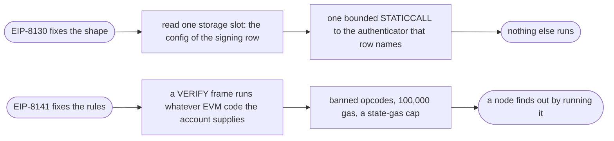
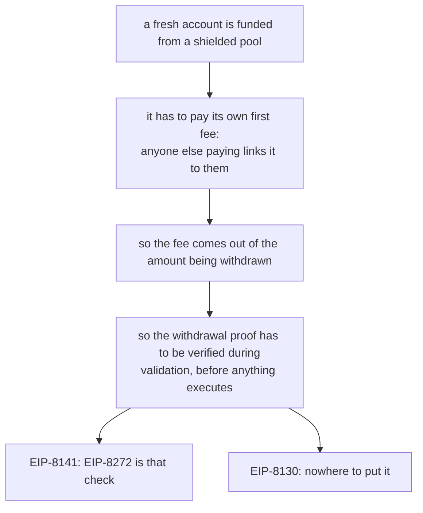

# Where 8130 and 8141 disagree [Where EIP-8130 and EIP-8141 differ, what we have decided, what we ask EIP-8130 for, and what is still open.]

A user should not have to care which chain they are on. Their keys, limits and permissions should behave the same on Base and on Ethereum. That is hard because the account runs on two transports. On Base it is an EIP-8130 transaction. On Ethereum L1 after Hegotá it is an EIP-8141 frame transaction. The two disagree about what a node may do while it validates a transaction, and almost everything on this page comes out of that disagreement.

|  | EIP-8130 | EIP-8141 |
| --- | --- | --- |
| **What validation is** | one storage read plus one declared call | arbitrary EVM inside a VERIFY frame |
| **What holds it in check** | the shape itself | banned opcodes, a 100,000 gas cap, a state-gas cap |
| **When a node knows the cost** | before it starts | by running it |
| **Room for a new validation step** | none, the shape is fixed | yes, EIP-8272 is one |
| **Shipping** | :badge[Live on Base]{success} | :badge[Scheduled for Hegotá]{info} |

Both designs are defensible. A fixed shape is cheap for a node to reason about, and it has no slot for a new step. An open shape can take new steps, and each new step is something a node has to be protected from.

## The items

| Item | The constraint | Status |
| --- | --- | --- |
| [Reading the Keystore](#reading-the-keystore) | frames ban reading another contract's storage during validation | :badge[Decided]{success} |
| [Post-quantum keys](#post-quantum-keys) | neither side's gas cap fits a hash-based verifier yet | :badge[Decided]{success} |
| [Nonce-free mode](#nonce-free-mode) | frames have no replay buffer | :badge[Decided]{success} |
| [Checking the result on 8130](#checking-the-result-on-8130) | 8130 runs nothing after execution | :badge[Request to 8130]{info} |
| [Adding a step to validation](#adding-a-step-to-validation) | 8130's validation shape is fixed | :badge[Stretch request to 8130]{info} |
| [Who pays for gas](#who-pays-for-gas) | a sponsor signs on 8130 and decides in code on 8141 | :badge[Open]{warning} |
| [Sending ETH in a batch](#sending-eth-in-a-batch) | 8130 calls run with `value = 0` | :badge[Open]{warning} |
| [Nonce lanes on L1](#nonce-lanes-on-l1) | the 8141 mempool holds one pending transaction per sender | :badge[Open]{warning} |

## What we have decided

:::note[Where we made a call]
Each of these is a choice, and someone can disagree with it. The reasoning is written out so the disagreement can be specific.
:::

### Reading the Keystore

EIP-8141 bans `SLOAD` on any storage other than the sender's inside the validation prefix. An account shaped like EIP-8130 keeps its rows in the Keystore, and the Keystore is a separate contract. As the text stands, reading a row during validation breaks that rule.

We are asking for a mempool exemption. EIP-8141 already has exemptions for the expiry verifier at `0x8141` and for canonical paymasters, so the mechanism exists. The only question is whether the Keystore belongs in the same category. We think it does. It is one canonical contract, it has a known layout, and the reads are bounded.

The request exists in writing. [ethereum/EIPs#12340](https://github.com/ethereum/EIPs/pull/12340) adds an optional chain parameter that lets a chain allow Keystore reads under 8141's mempool rules. It came out of ERC-8403, a draft standard for key changes across both designs. A plain Keystore read is our preferred route. [ERC-8403 and the Keystore read](/research/erc-8403) explains the draft, why we prefer the plain read, and the questions still open.

:::details[What we do if the exemption is refused]
The fallback is to mirror every key row into the sender's own storage, which keeps validation inside the rule as written. It works. It also costs gas on every key change for as long as the account exists, and key changes are what this account model is built to make cheap. Adding a passkey, rotating a hardware wallet and granting an app permission would all cost more on L1 than on Base, permanently.
:::

We treat this as our own work. It is also the item the rest of the design leans on. Without it, an 8130-shaped account runs on L1 only by paying the mirroring cost, and every user of it pays that cost.

### Post-quantum keys

We commit to a mechanism and do not pick a scheme. A signature scheme is a verifier contract plus a Keystore row that names it. Whichever scheme the ecosystem settles on can go into an account that already exists, at the same address, without a fork.

The schemes do not fit the gas budget yet. A VERIFY prefix is capped at 100,000 gas including the signature check, and EIP-8130 suggests the same ceiling for authentication.

| Verifier | Verification gas | Inside the 100,000 cap? |
| --- | --- | --- |
| SLH-DSA-Keccak-128-24 | ~94,000 | :badge[Nothing left over]{warning} |
| SPHINCS- C13 | ~127,000 | :badge[No]{danger} |
| SPHINCS- C11/C12, for hardware wallets | ~276,000 | :badge[No]{danger} |
| any scheme, aggregated per block | ~3,000 | :badge[Yes, once aggregation lands]{success} |

The cap covers the whole prefix, so even the cheapest of those leaves nothing for the rest of validation. The gap closes with block-level proof aggregation or with a precompile, and neither of those is ours to ship. A post-quantum row can be added to an account today, but its signature check cannot yet run inside the budget. We are not claiming a post-quantum key works in the public mempool. The [post-quantum keys](/docs/post-quantum) page has the full figures.

### Nonce-free mode

EIP-8130 can drop nonce ordering and use a replay buffer instead. Frames have no equivalent. The nearest substitute is the expiry verifier plus a replay set kept in the account's own storage, and that costs state gas on every transaction. Nonce-free mode exists to cost nothing, so a substitute that charges every time defeats its purpose.

We are not building it on frames. An account has nonce-free mode on Base and does not have it on L1, and the wallet says which applies on its network screen. We are keeping this difference on purpose, so nobody should expect it to be closed later.

## What we ask EIP-8130 for

These are changes to EIP-8130 that we request. We do not fork 8130 to get them. If a request is refused, PACE keeps the weaker behaviour described under each one.

### Checking the result on 8130

EIP-8130 has no POST_TX equivalent, so an EIP-7906 assertion has nowhere to run once execution is finished. The nearest thing is an ordinary call at the end of the batch, and the way `calls` works limits what that call can check.

Phases commit independently. A revert in a later phase does not undo an earlier one, so the assertion has to be the last call inside the phase it guards, and it guards only that phase. An ordinary call also reads current state and cannot read the transaction's diff, because `TXTRACE` and `TXDIFF` are legal only inside a POST_TX frame.

| What the wallet wants to assert | On EIP-8141 | On EIP-8130 |
| --- | --- | --- |
| I spend at most X | POST_TX reads the diff | a final call reads the balance |
| I receive at least Y | POST_TX reads the diff | a final call reads the balance |
| Nothing else of mine changed | POST_TX reads the diff | nothing to compare against |

:::details[Getting the third row back]
A wallet can recover "nothing else of mine changed" by snapshotting every value it cares about in a first call, then comparing in the last call of the same phase. It pays for both calls, and it has to know in advance which values matter. A state diff would have told it that.
:::

**The request.** We ask EIP-8130 to add one call that runs after all phases have executed and that can revert all of them if it fails. It is what EIP-7906's POST_TX frame does on frames. With it, the same assertion contract runs the same way on both transports, and the table above collapses to one column. Until 8130 has it, the snapshot workaround above is what ships.

### Adding a step to validation

EIP-8272 adds a canonical VERIFY frame to EIP-8141 that checks recent state roots. EIP-8130 has no slot for anything equivalent, because its validation is one storage read plus one declared call and that shape is fixed.

Private funding is where this shows up.

The payer rules make it worse. On Base the private funding path ends up needing a named relayer to sign for the user, and a relayer in the path contradicts this proposal's goal of having none. We say so here so that the [privacy](/docs/extensions#private-balance) page does not read as though this works on both transports.

**The request, as a stretch goal.** We ask EIP-8130 for a way for both the gas and the user's funds to come from a privacy protocol in one transaction. It is a stretch goal because it touches the part of 8130 that is fixed on purpose, and nothing else in PACE depends on it.

## What is open

:::warning[Not solved yet]
Each of these is a real gap with a mechanism behind it. The mechanism is written out so someone can work on it.
:::

### Who pays for gas

EIP-8130 takes a `payer` and a `payer_auth`. A named sponsor signs the one transaction it is paying for. EIP-8141 makes a sponsor a paymaster contract that decides for itself while the transaction validates, and gives a paymaster the mempool does not treat as canonical one pending transaction.

|  | EIP-8130 | EIP-8141 |
| --- | --- | --- |
| **What a sponsor is** | a named account with a `payer_auth` | a paymaster contract |
| **When it decides** | when it signs, before broadcast | during validation, in code |
| **"I pay for anyone who proves X"** | no, it has to see and sign each one | yes |
| **Sponsoring at volume** | yes | only as a canonical paymaster |

Each side does something the other cannot. The practical problem is that an account with a sponsor behaves differently depending on its chain, and there is no single shape to describe that to an app. `wallet_getCapabilities` reports per chain, so an app can at least find out what it is dealing with. It cannot ask for one arrangement that holds on both.

### Sending ETH in a batch

|  | EIP-8130 | EIP-8141 |
| --- | --- | --- |
| **`value` on a call** | always `0` | carried by the frame |
| **A batch that sends ETH** | has to be restructured | works as written |

We have not settled what that restructuring should look like. It is the smallest item here and probably the easiest to resolve. It is still a real difference in what one signed batch can express, which is why it is on the list.

### Nonce lanes on L1

EIP-8130 has nonce lanes built in, and its mempool can hold independent transactions from one account on different lanes. EIP-8250 adds keyed nonces to frames but keeps EIP-8141's rule of one pending transaction per sender. So lanes work inside blocks on L1, but a second transaction from the same account waits outside the public mempool until the first one lands. The fix is a mempool rule that admits one pending transaction per sender and lane, with a cap on lanes per sender. We ask L1 client teams for it.

## Why this page exists

Anyone implementing PACE will run into these items. Writing them down now saves every team that builds on it from finding them again.

The decided items are positions we will defend. The requests are what we bring to the EIP-8130 authors. The open items are what we would bring to a working group. [What we need to do](/docs/what-has-to-change) lists the ones PACE depends on next to the rest of the work.
